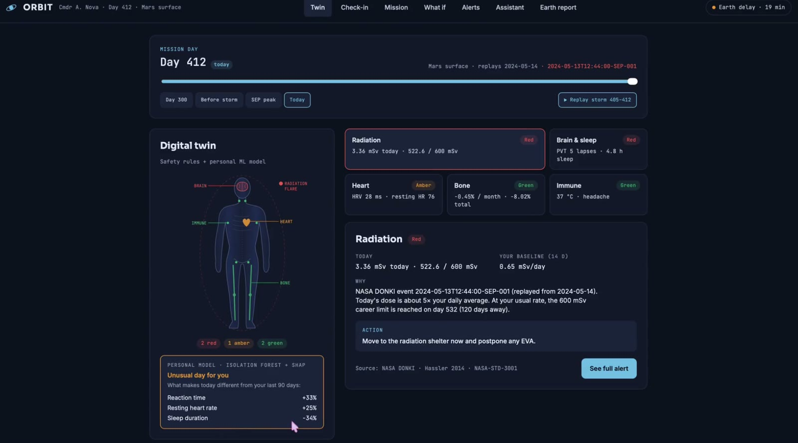
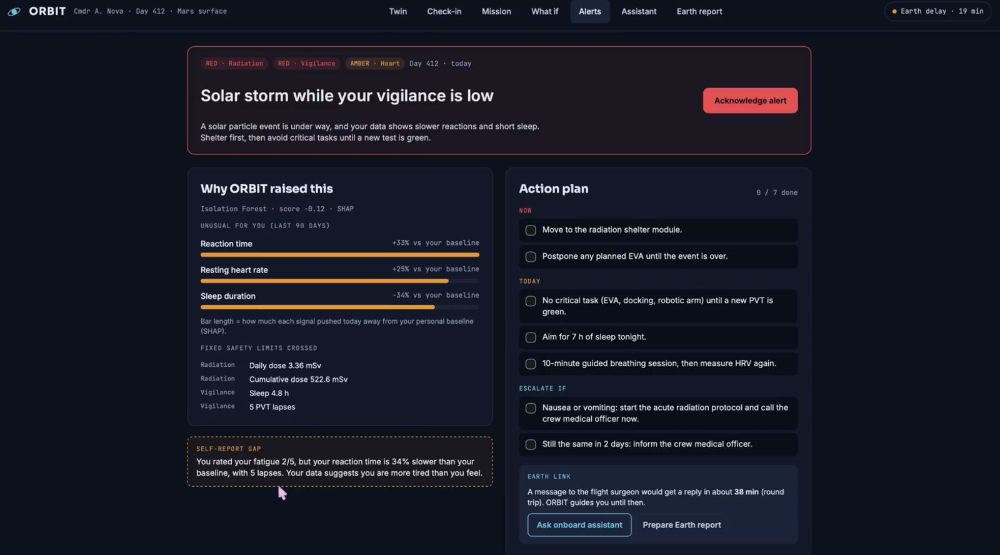
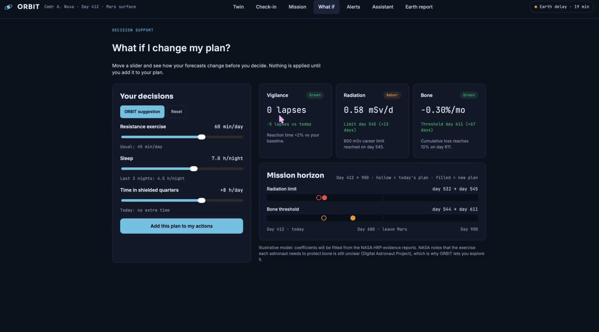
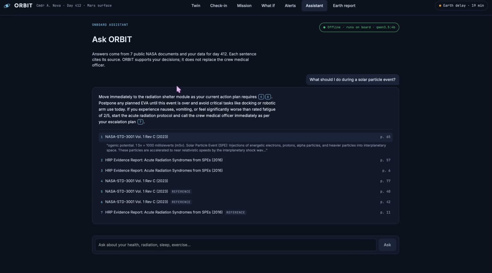
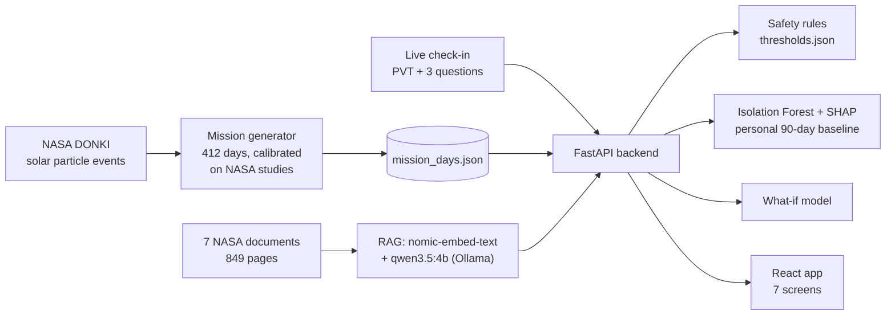

# ORBIT

**An AI health co-pilot for astronauts, built for the day Earth is too far away to help.**

*NASA International Space Apps Challenge 2026 · Casablanca*

🎬 **Demo video (30 s):** _link coming soon_ · 📚 **Sources:** [SOURCES.md](SOURCES.md)



---

## The problem

On a mission to Mars, a message to Earth takes up to ~20 minutes one way. There is no doctor on call. Astronauts face radiation, isolation, altered gravity and a closed environment, and they carry much of the responsibility for spotting health changes in themselves. Inflight health information already relies heavily on crew self-report, and people under stress often say *"I'm fine"* when they are not.

## What ORBIT does

ORBIT helps an astronaut **measure, understand and act on** their own health without Earth. It is crew-facing decision support in the spirit of NASA's **Earth-Independent Medical Operations (EIMO)**: it advises and explains, it does not replace the crew medical officer.

The demo follows **Cmdr A. Nova**, a fictional astronaut on day 412 of a Mars mission, during a replay of the **real May 2024 solar superstorm** (NASA DONKI).

| Screen | What it does |
|---|---|
| **Check-in** | A live Psychomotor Vigilance Test (PVT-B, Basner et al. 2011) and 3 questions. This is real data, measured from the user. |
| **Digital twin** | A body view with 5 systems (radiation, brain & sleep, heart, bone, immune). Replay any mission day, or the storm day by day. |
| **Mission** | Cumulative radiation dose over 900 days with forecast and the 600 mSv career limit, real solar events, and the days the AI flagged. |
| **What if** | Test a decision before taking it (sleep, exercise, shielding) and see the forecasts move. |
| **Alerts** | Why ORBIT raised an alert (SHAP + safety rules) and a tickable action plan: now, today, escalate if. |
| **Assistant** | An offline AI assistant that answers from NASA documents and cites the page. |
| **Earth report** | A compact report for the flight surgeon, about 1 KB compressed, with the 19-minute delay each way. |

### What makes it different

- **Personal baseline, not population averages.** A per-astronaut Isolation Forest (previous 90 days, retrained weekly) flags days that are unusual *for her*, and SHAP says which signals and by how much. On day 412 the fixed safety thresholds call the heart green, but the model sees it is unusual for Nova and raises it to amber.
- **Self-report gap.** ORBIT compares what the astronaut *says* with what the data *shows*: *"You rated your fatigue 2/5, but your reaction time is 34% slower than your baseline, with 5 lapses."*
- **Real NASA data at the core.** Solar particle events from **NASA DONKI** are replayed on the mission timeline (106 records on 61 mission days), and the assistant cites **NASA-STD-3001** and **HRP Evidence Reports**.
- **Works without Earth.** The assistant runs a local open-weight model (no internet), and the Earth report is built for a slow, delayed link.

### All five NASA spaceflight hazards (RIDGE)

| NASA hazard | In ORBIT |
|---|---|
| **R**adiation | Radiation system, real DONKI solar particle events, 600 mSv career limit forecast, shielding in What-if |
| **I**solation & confinement | Check-in mood and fatigue, PVT vigilance test, self-report gap |
| **D**istance from Earth | 19-minute delay shown everywhere, offline assistant, bandwidth-aware Earth report |
| **G**ravity fields | Bone density loss and cardiovascular signals (HRV, resting heart rate) |
| **H**ostile & closed environment | Immune system (fever episode), anomaly detection on all signals |

## Screenshots

| Alerts: why, and what to do | What if: test a decision first |
|---|---|
|  |  |

| Offline assistant with NASA citations |
|---|
|  |

## How it works



| Part | Tech | Where |
|---|---|---|
| Frontend | React 19, Vite | [`frontend/`](frontend/) |
| Backend | FastAPI, Pydantic | [`backend/`](backend/README.md) |
| Anomaly detection | scikit-learn Isolation Forest, SHAP TreeExplainer | [`backend/app/ml.py`](backend/app/ml.py) |
| Assistant | Ollama (`qwen3.5:4b`, `nomic-embed-text`), pypdf, streamed answers with citations | [`backend/app/rag.py`](backend/app/rag.py) |
| Mission data | Python generator, real NASA DONKI events | [`data_gen/`](data_gen/README.md) |
| Tests | 38 pytest + 16 node:test | `backend/tests/`, `frontend/src/lib/*.test.js` |

## Run it locally

You need Python 3.12+ with [uv](https://docs.astral.sh/uv/), Node 22+, and [Ollama](https://ollama.com/) for the assistant.

```bash
# 1. Backend (port 8010)
cd backend
uv venv .venv && uv pip install -p .venv -r requirements.txt
.venv/bin/uvicorn app.main:app --port 8010
```

```bash
# 2. Frontend (port 5175), in a second terminal
cd frontend
npm install
npm run dev -- --port 5175
```

Open http://localhost:5175.

For the assistant, put the 7 NASA PDFs listed in [SOURCES.md](SOURCES.md) in `rag_docs/`, then:

```bash
ollama pull qwen3.5:4b && ollama pull nomic-embed-text
cd backend && .venv/bin/python -m app.rag build
```

Regenerate the mission data (optional, the result is committed):

```bash
NASA_API_KEY=your_key python3 data_gen/fetch_donki.py
python3 data_gen/generate.py
```

## Data, validity and limits

- **The astronaut is fictional.** Individual astronaut medical data is confidential. Nova's 412 days are simulated and **calibrated on published figures**: Zeitlin 2013 (transit dose), Hassler 2014 (Mars surface dose), Barger 2014 (sleep), Stahn 2017 (core temperature), the HRP bone report. Every value without a direct source is listed as an **ORBIT assumption** in [SOURCES.md](SOURCES.md) and [data_gen/README.md](data_gen/README.md).
- **Space weather is real.** Solar particle events come from NASA DONKI. The DONKI flare endpoint was unavailable when we downloaded the data, so flares are not replayed yet.
- **The check-in is real.** The PVT measures your own reaction times in the browser; results are kept in memory only.
- **The What-if coefficients are illustrative.** They are linear assumptions to be fitted on the HRP evidence reports.
- **The assistant can be wrong.** It answers only from retrieved NASA excerpts and verified reference thresholds, and it supports, not replaces, the crew medical officer.

## Team

- **Meryeme**: AI/ML and full-stack
- **Oussama**: data science

## License

[Apache 2.0](LICENSE). NASA documents and data are public; all sources and licenses are listed in [SOURCES.md](SOURCES.md).
